# 01. Ringkasan Eksekutif & Arsitektur Sistem
## Digital Earth Indonesia WebGIS

---

## 1. Visi & Latar Belakang Proyek

**Digital Earth Indonesia WebGIS** adalah aplikasi pemetaan interaktif modern berbasis web (*browser-native*) yang dirancang untuk menjembatani data penginderaan jauh (*Earth Observation*) skala planet dengan kebutuhan praktis analisis spasial di Indonesia.

Proyek ini mengatasi sejumlah tantangan umum dalam implementasi WebGIS tradisional:
1. **Aksesibilitas Data Satelit**: Citra satelit Sentinel-2, Landsat, dan data iklim MODIS sering kali tersimpan dalam format mentah (*GeoTIFF*, *NetCDF*) yang memerlukan software SIG desktop berat. WebGIS ini menyajikannya secara *real-time* via OGC WMS (Open Data Cube BIG Piksel) dan komputasi serverless Google Earth Engine (GEE).
2. **Kinerja Rendah di Browser**: Rendering dataset vektor dan raster berukuran besar sering membuat browser lambat. Dengan beralih ke **MapLibre GL JS (WebGL2)** dan komputasi spasial modular **Turf.js**, seluruh proses visualisasi dan kalkulasi geodesik berjalan lancar langsung di perangkat pengguna.
3. **Penyajian Data 3D Multidimensi**: Menggabungkan elevasi topografi medan 3D (AWS Terrarium DEM) dengan ekstrusi volume gedung 3D (OpenFreeMap) untuk visualisasi wilayah perkotaan dan bentang alam Indonesia.

---

## 2. Diagram Arsitektur Sistem

Arsitektur WebGIS ini mengusung pendekatan **Jamstack / Serverless Client-First**, di mana sebagian besar beban kalkulasi dan visualisasi dijalankan pada klien peramban, sementara pemanggilan data yang membutuhkan komputasi berat dialihkan ke *edge proxy* dan serverless microservices.

```mermaid
graph TD
    subgraph Browser_Client["Klien Peramban (Client-Side / WebGL2)"]
        UI["Antarmuka UI (Sidebar, Dock, Modals, Popovers)"]
        
        subgraph Orchestration["Inti Aplikasi"]
            App["WebGISApp (src/main.ts)"]
            MM["MapManager (src/map/map-manager.ts)"]
            Canvas["MapLibre GL Canvas (WebGL2 Engine)"]
        end

        subgraph Spatial_Engines["Mesin Analisis & Alat Spasial"]
            Measure["MeasureTool (src/tools/measure.ts)"]
            Buffer["SpatialBuffer (src/tools/spatial-buffer.ts)"]
            Intersect["SpatialIntersect (src/tools/spatial-intersect.ts)"]
            Inspector["PointInspector (src/tools/point-inspector.ts)"]
            Export["MapExporter (src/tools/map-exporter.ts)"]
            AI["AINavigator (src/tools/ai-navigator.ts)"]
        end

        subgraph Loaders["Penyedia Lapisan Data"]
            Piksel["PikselLoader (BIG Piksel WMS)"]
            GEEClient["GEELoader (GEE / NASA GIBS)"]
            GeoJSON["GeoJsonLoader (Shapefile, GeoJSON, KML, CSV)"]
            Basemap["BasemapCustomizer (16 Peta Dasar)"]
        end

        UI --> App
        App --> MM
        MM --> Canvas
        App --> Measure & Buffer & Intersect & Inspector & Export & AI
        App --> Piksel & GEEClient & GeoJSON & Basemap
    end

    subgraph Edge_Serverless["Lapisan Vercel Edge & Serverless Functions (/api/*)"]
        WMSProxy["/api/wms-proxy (Edge WMS Proxy & Rate Limiter)"]
        GEEZonal["/api/gee-zonal-stats (Serverless GEE Node.js)"]
        GEELST["/api/gee-lst-tiles (Serverless Thermal Engine)"]
        GEERain["/api/gee-precipitation-tiles (Serverless CHIRPS)"]
        GeminiCopilot["/api/gemini-navigator (Edge Gemini AI Copilot)"]
    end

    subgraph Upstream_Services["Penyedia Data Geospasial Hulu (External Upstream)"]
        BIG["BIG Piksel WMS (ows.staging.piksel.big.go.id)"]
        GEECluster["Google Earth Engine API (Google Cloud Cluster)"]
        NASA["NASA GIBS Earthdata Cloud"]
        DEMService["AWS Open Data Terrarium 30m Global DEM"]
        VectorTiles["OpenFreeMap / MapTiler / Esri REST Services"]
        GeminiAPI["Google Gemini 1.5 Pro / Flash API"]
    end

    %% Koneksi Jaringan
    Piksel -->|Ubin WMS melalui Proxy| WMSProxy
    WMSProxy -->|OGC WMS 1.3.0 GetMap| BIG
    
    GEEClient -->|Kueri Statistik Zonal| GEEZonal
    GEEZonal -->|Earth Engine API Private Key| GEECluster
    
    GEEClient -->|Ubin Termal GEE| GEELST
    GEEClient -->|Ubin Presipitasi GEE| GEERain
    GEEClient -->|Langsung via WMS| NASA

    AI -->|Percakapan & Tool Calling| GeminiCopilot
    GeminiCopilot -->|REST Generative API| GeminiAPI

    Basemap -->|Vector & Raster Tiles| VectorTiles
    MM -->|Terrain Mesh Elevation| DEMService
```



---

## 3. Peta Direktori & Struktur Kode

```
webgis/
├── api/                             # Vercel Serverless & Edge API Endpoints
│   ├── _rate-limit.ts               # In-memory sliding window rate limiter
│   ├── gee-export-tiff.ts           # Ekspor citra GeoTIFF beresolusi tinggi dari GEE
│   ├── gee-landcover-tiles.ts       # Endpoint ubin ESA WorldCover
│   ├── gee-lst-tiles.ts             # Endpoint ubin MODIS Land Surface Temp
│   ├── gee-precipitation-tiles.ts   # Endpoint ubin presipitasi satelit CHIRPS
│   ├── gee-timeseries.ts            # Data runtun waktu musiman (LST vs CFSv2)
│   ├── gee-zonal-stats.ts           # Live planetary reduction poligon pengguna
│   ├── gemini-navigator.ts          # Edge AI Map Copilot dengan Function Calling
│   └── wms-proxy.ts                 # Caching proxy untuk OGC WMS BIG Piksel
├── dokumen-handoff/                 # Paket Dokumentasi Serah Terima Proyek
├── public/                          # Aset statis peramban (Favicon, Manifest, SW, PWA icons)
├── src/                             # Sumber kode utama aplikasi (TypeScript)
│   ├── config/                      # Konfigurasi deklaratif basemaps & dataset Piksel
│   │   ├── basemaps.ts              # Registri 16 peta dasar (Esri, BIG RBI, OSM, dsb.)
│   │   └── piksel.ts                # Metadata produk Sentinel-2, Landsat, Preset
│   ├── map/                         # Mesin peta dasar MapLibre
│   │   └── map-manager.ts           # Pembungkus MapLibre, inisialisasi gaya, proyeksi globe/mercator
│   ├── tools/                       # Logika bisnis geospasial & modul analitik
│   │   ├── ai-navigator.ts          # Klien asisten AI interaktif
│   │   ├── basemap-customizer.ts    # Filter visual & kontrol sublayer vektor
│   │   ├── eco-mode.ts              # Penghemat daya/GPU berbasis telemetri perangkat
│   │   ├── gee-loader.ts            # Pemuat ubin GEE & komposit NASA GIBS
│   │   ├── geocoder.ts              # Pencarian alamat & lokasi (Nominatim / Photon)
│   │   ├── geojson-loader.ts        # Parser & pengelola layer vektor kustom
│   │   ├── map-exporter.ts          # Generator cetak peta resolusi tinggi (PNG/JPEG)
│   │   ├── map-loading-indicator.ts # Indikator pemuatan ubin real-time
│   │   ├── measure.ts               # Pengukuran jarak geodesik, luas, & profil elevasi
│   │   ├── permalink.ts             # Sinkronisasi status peta dengan URL Hash
│   │   ├── piksel-loader.ts         # Pemuat komposit Sentinel-2 & Time-Lapse Player
│   │   ├── point-inspector.ts       # Inspektur koordinat titik, elevasi & reverse geocoding
│   │   ├── spatial-analysis.ts      # Statistik tutupan lahan pada poligon AOI
│   │   ├── spatial-buffer.ts        # Kalkulator zona penyangga geodesik (Turf.js)
│   │   ├── spatial-intersect.ts     # Mesin tumpang tindih spasial (Overlay/Intersection)
│   │   └── swipe-compare.ts         # Tirai pembanding 2 peta berdampingan
│   ├── ui/                          # Komponen antarmuka pengguna (DOM-driven)
│   │   ├── active-layers.ts         # Pengatur tumpukan lapisan & opasitas
│   │   ├── ai-assistant-dock.ts     # Panel dok asisten pintar di bagian bawah
│   │   ├── attribute-table-panel.ts # Tabel data atribut spasial & pencarian
│   │   ├── basemap-customizer-panel.ts # Panel kontrol filter visual & sublapisan
│   │   ├── buffer-analysis-ui.ts    # Panel pengaturan radius buffer
│   │   ├── command-palette.ts       # Menu spotlight cepat (Ctrl+K)
│   │   ├── data-panel.ts            # Panel impor/ekspor data vektor
│   │   ├── dynamic-legend.ts        # Legenda peta dinamis kontekstual
│   │   ├── gee-panel.ts             # Panel kontrol data satelit GEE
│   │   ├── guided-tour.ts           # Tur panduan interaktif 6 langkah
│   │   ├── overview-map.ts          # Inset peta kecil (minimap)
│   │   ├── piksel-panel.ts          # Panel kontrol citra satelit BIG Piksel
│   │   ├── search-ui.ts             # Kotak pencarian lokasi di bilah atas
│   │   ├── shortcuts-modal.ts       # Dialog panduan tombol pintas keyboard
│   │   ├── sidebar.ts               # Bilah navigasi samping utama (8 Tab)
│   │   ├── spatial-analysis-ui.ts   # Panel visualisasi statistik zonal AOI
│   │   ├── status-bar.ts            # Bilah status bawah (koordinat, zoom, FPS, eco)
│   │   ├── swipe-compare-ui.ts      # Pengatur tirai pembanding
│   │   └── toast.ts                 # Notifikasi toast interaktif
│   ├── utils/                       # Utilitas pendukung & pustaka pembantu
│   │   ├── a11y.ts                  # Aksesibilitas, fokus keyboard & screen reader
│   │   ├── csv-parser.ts            # Deteksi otomatis kolom lintang/bujur pada CSV
│   │   ├── error-handler.ts         # Penangkap galat global & monitor koneksi internet
│   │   ├── kml-exporter.ts          # Generator berkas KML XML yang disanitisasi
│   │   ├── kml-parser.ts            # Parser berkas KML ke GeoJSON
│   │   ├── logger.ts                # Sistem pencatat log konsol terkendali
│   │   ├── sanitize.ts              # Sanitasi string anti-XSS untuk data input
│   │   └── shapefile-parser.ts      # Parser arsip ZIP Shapefile ke GeoJSON
│   ├── main.ts                      # Titik masuk utama aplikasi (Orchestrator)
│   └── style.css                    # Lembar gaya global bertema Glassmorphism Modern
├── tests/                           # Pengujian unit & integrasi otomatis (40 file, 294 tes)
├── index.html                       # Kerangka HTML utama aplikasi
├── package.json                     # Definisi dependensi & skrip proyek
├── tsconfig.json                    # Konfigurasi kompilator TypeScript
├── vercel.json                      # Konfigurasi routing, cache & header CSP di Vercel
└── vite.config.ts                   # Konfigurasi build bundler Vite
```

---

## 4. Tumpukan Teknologi & Alasan Pemilihan

| Komponen | Pustaka / Teknologi | Alasan Pemilihan |
| :--- | :--- | :--- |
| **Peta Inti (Core Map)** | **MapLibre GL JS v6.10** | Open-source murni, bebas lisensi berbayar Mapbox, mendukung penuh akselerasi WebGL2 untuk rendering jutaan titik, elevasi medan 3D (*terrain mesh*), dan ekstrusi gedung 3D secara mulus pada 60 FPS. |
| **Kalkulasi Spasial** | **Turf.js v7.4 (Modular)** | Standar de-facto algoritma geospasial pada JavaScript. Menjalankan kalkulasi geodesik (jarak pada elipsoid WGS84, poligon buffer, luas sebenarnya, dan tumpang tindih spasial). |
| **Runtime & Bundler** | **Bun 1.2+ & Vite 6** | Bun menyediakan instalasi paket hingga 10x lebih cepat dibanding npm tradisional. Vite 6 menawarkan *Hot Module Replacement (HMR)* instan serta pembagian chunk produksi yang teroptimasi. |
| **Bahasa Pemrograman** | **TypeScript 5.9** | Mode ketat (*strict mode*) menjamin keandalan tipe data antarmuka GeoJSON, MapLibre events, dan mencegah galat *undefined* saat runtime. |
| **Parsing Multi-Format** | **shpjs, toGeoJSON** | Memungkinkan impor arsip Shapefile `.zip` (memuat `.shp`, `.dbf`, `.prj`) dan berkas `.kml` langsung di dalam browser tanpa harus mengunggah file pengguna ke server eksternal (menjaga privasi). |
| **Hosting & Edge API** | **Vercel Edge & Serverless** | Menyediakan jaringan CDN global berlatensi rendah untuk ubin raster/vektor dan komputasi fungsi nirserver untuk integrasi API Google Earth Engine dan Gemini AI. |

---

## 5. Pola Desain & Arsitektur Alur Kerja

### A. Pola Desain (Design Patterns)
1. **Orchestrator Facade (`WebGISApp`)**: Kelas utama [src/main.ts](file:///d:/webgis/src/main.ts) bertindak sebagai fasad orkestrasi yang menginstansiasi seluruh modul, mendaftarkan *event listener* global, dan mengatur siklus hidup komponen tanpa membuat modul-modul saling berketergantungan secara acak (*loose coupling*).
2. **Event-Driven Pub/Sub via CustomEvents**: Komunikasi antar modul menggunakan antrean kejadian terstandarisasi, misalnya:
   - `webgis:sidebar-tab-change`: Memberitahukan bahwa tab laci telah berpindah, sehingga alat yang sedang aktif (seperti pengukuran) dapat menyelesaikan pekerjaannya secara rapi.
   - `webgis:cancel-active-measure`: Menjaga prinsip *mutual exclusion* (hanya boleh ada satu alat penggambaran yang aktif pada satu waktu).
3. **Singleton Services**: [ErrorHandler](file:///d:/webgis/src/utils/error-handler.ts) diimplementasikan sebagai Singleton agar pelaporan status jaringan (*online/offline*) dan penanganan galat jaringan konsisten di seluruh lapisan aplikasi.

### B. Matriks Urutan Tumpukan Lapisan (Layer Stacking Order)
Salah satu tantangan terbesar pada aplikasi WebGIS multi-layer adalah lapisan vektor sering kali tertutup oleh lapisan citra satelit atau peta dasar jika urutan rendering tidak dijaga.

WebGIS ini menerapkan fungsi terpusat `enforceLayerOrder()` di dalam [MapManager](file:///d:/webgis/src/map/map-manager.ts#L480-L550) yang secara deterministik menyusun lapisan dari posisi terbawah ke teratas:

$$\begin{array}{rll}
\text{Lapisan Paling Atas (Visual Utama)} & \longrightarrow & \text{1. Tooltip & Marker Interaktif} \\
& \longrightarrow & \text{2. Garis & Titik Pengukuran / Jarak Geodesik} \\
& \longrightarrow & \text{3. Poligon Luas Ukur & Zona Buffer Geodesik} \\
& \longrightarrow & \text{4. Lapisan Vektor Kustom Pengguna (Shapefile / GeoJSON)} \\
& \longrightarrow & \text{5. Ekstrusi Bangunan 3D (3D Buildings)} \\
& \longrightarrow & \text{6. Grid Batas Ubin Open Data Cube (ODC)} \\
& \longrightarrow & \text{7. Ubin Tematik GEE (LST Suhu & Presipitasi CHIRPS)} \\
& \longrightarrow & \text{8. Citra Satelit BIG Piksel Sentinel-2 & Landsat 9} \\
& \longrightarrow & \text{9. Lapisan Peta Dasar (Basemap Raster / Vector)} \\
\text{Lapisan Paling Bawah (Pondasi Medan)} & \longrightarrow & \text{10. Mesh Elevasi 3D Medan (AWS Terrarium DEM)}
\end{array}$$

Dengan matriks deterministik ini, setiap kali pengguna mengganti peta dasar (*basemap*) atau menyalakan citra satelit baru, geometri pengukuran dan data vektor pengguna dijamin **selalu tampak di atas dan tidak akan pernah tertutup**.
