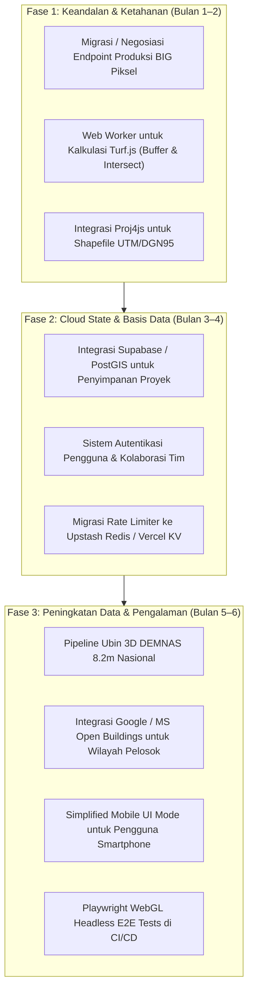

# 05. Audit Kekurangan Sistem & Roadmap Pengembangan
## Digital Earth Indonesia WebGIS

Dokumen ini menyajikan hasil **audit teknis mendalam dan objektif** mengenai keterbatasan, kelemahan arsitektural (*technical debt*), potensi titik kegagalan (*single point of failure*), serta rekomendasi peta jalan perbaikan (*actionable roadmap*) untuk pengembang berikutnya.

---

## 1. Ringkasan Skor Kesiapan Sistem (Readiness Scorecard)

| Aspek Sistem | Skor (1–10) | Status | Keterangan Singkat |
| :--- | :---: | :---: | :--- |
| **Arsitektur Klien & UI WebGL2** | **9.2** | 🟢 Sangat Baik | MapLibre GL 6.10 stabil, responsive glassmorphism, 60 FPS, didukung Eco-Mode. |
| **Fungsionalitas Spasial & Geodesik** | **9.0** | 🟢 Sangat Baik | 8 modul analitik lengkap (Ukur, Buffer, Intersect, Zonal, Swipe, Export, AI). |
| **Kualitas Kode & Unit Testing** | **8.8** | 🟢 Sangat Baik | TypeScript strict, 40 test files, 294 Vitest tests passing (100% green). |
| **Keamanan Klien & CSP** | **8.5** | 🟢 Baik | Sanitasi input XSS ketat, Content Security Policy deklaratif di Vercel. |
| **Dukungan Mobile & Responsivitas** | **7.5** | 🟡 Cukup | Touch drawer aktif, namun panel data padat tetap lebih nyaman di desktop. |
| **Skalabilitas State Serverless** | **6.0** | 🟠 Perlu Atensi | Rate limiter dan kuota harian masih in-memory di tingkat edge instance. |
| **Persistensi Data & Basis Data** | **5.5** | 🔴 Keterbatasan Utama | Belum memiliki database cloud / sistem login; data murni di `localStorage`. |
| **Ketahanan Sumber Hulu (Upstream)** | **5.0** | 🔴 Keterbatasan Utama | Sangat bergantung pada ketersediaan server *staging* OGC WMS BIG Piksel. |

---

## 2. Rincian 9 Kekurangan & Keterbatasan Teknis Utama

### 🔴 1. Ketergantungan Tunggal pada Server Upstream Staging (Single Point of Failure)
* **Temuan**: Layanan citra satelit Sentinel-2 GeoMAD 10m (2017–2025) dan indeks spektral bergantung langsung pada alamat hulu `ows.staging.piksel.big.go.id` melalui proxy `/api/wms-proxy`.
* **Kelemahan & Dampak**:
  * Domain berlabel **`staging`** menandakan server pengujian internal yang tidak memiliki jaminan tingkat ketersediaan (*Service Level Agreement / SLA 99.9%*).
  * Jika server BIG sedang mengalami *maintenance*, *overload*, atau perubahan sertifikat SSL, seluruh lapisan citra satelit dan fungsi time-lapse di aplikasi akan gagal dimuat atau mengalami *timeout*.
* **Rekomendasi Solusi**:
  1. Melakukan negosiasi atau permohonan resmi ke Badan Informasi Geospasial untuk mendapatkan akses ke *endpoint production* klaster resmi BIG Piksel.
  2. Menerapkan mekanisme *stale fallback caching* jangka panjang (misal menyimpan ubin tahun-tahun statis 2017–2023 pada bucket Cloudflare R2 / AWS S3) agar peta tetap berfungsi saat server staging offline.
  3. Menambahkan *graceful error banner* di UI saat server hulu tidak merespons, alih-alih membiarkan peta kosong.

---

### 🔴 2. Ketiadaan Database Backend & Akun Pengguna (Stateless Architecture)
* **Temuan**: Aplikasi saat ini 100% *stateless* di sisi server. Fitur seperti *Saved Views* (tampilan tersimpan), penanda lokasi (*point bookmarks*), dan riwayat lapisan kustom hanya disimpan di dalam objek `localStorage` peramban lokal.
* **Kelemahan & Dampak**:
  * Jika pengguna membersihkan cache/riwayat browser, berganti perangkat (dari laptop ke ponsel), atau menggunakan mode *Incognito/Private*, seluruh data proyek dan bookmark yang telah dibuat akan hilang.
  * Tidak memungkinkan adanya fitur kolaborasi antar-tim (*sharing workspace*, menyimpan analisis tim, atau hak akses bertingkat admin/analis).
* **Rekomendasi Solusi**:
  1. Integrasikan backend BaaS (*Backend-as-a-Service*) ringan seperti **Supabase** atau **PostgreSQL + PostGIS**.
  2. Tambahkan autentikasi pengguna (misal: OAuth Google / GitHub via Supabase Auth) sehingga pengguna dapat menyimpan proyek analisis spasial mereka secara permanen di cloud.

---

### 🟠 3. Kalkulasi Spasial Berjalan di Main Thread (Risiko UI Freezing)
* **Temuan**: Seluruh kalkulasi geospasial Turf.js (kalkulasi poligon zona buffer [SpatialBuffer](file:///d:/webgis/src/tools/spatial-buffer.ts), irisan [SpatialIntersect](file:///d:/webgis/src/tools/spatial-intersect.ts), dan pengukuran poligon) dieksekusi langsung pada *main thread* JavaScript browser.
* **Kelemahan & Dampak**:
  * Saat pengguna mengimpor berkas ESRI Shapefile atau GeoJSON dengan ribuan fitur poligon rumit (misalnya batas desa seluruh provinsi Jawa Barat dengan > 20.000 simpul koordinat), kalkulasi buffer atau irisan spasial akan mengunci *main thread*.
  * Akibatnya, animasi peta dan kursor mouse dapat mengalami *freezing* atau lag beberapa detik (*unresponsive script warning*).
  * Saat ini sistem memitigasinya dengan membatasi kalkulasi buffer pada maksimal 1.000 fitur (`MAX_SAFE_FEATURES = 1000`), namun ini membatasi kapasitas dataset besar.
* **Rekomendasi Solusi**:
  1. Pindahkan modul kalkulasi Turf.js yang berat ke dalam **Web Worker** background menggunakan pustaka seperti `comlink`.
  2. Dengan Web Worker, proses komputasi buffer/intersect ribuan fitur dapat berjalan di latar belakang tanpa mengganggu kelancaran animasi kanvas MapLibre 60 FPS.

---

### 🟠 4. Pembatas Laju (Rate Limiter) Belum Terdistribusi
* **Temuan**: Modul pembatas laju [api/_rate-limit.ts](file:///d:/webgis/api/_rate-limit.ts) dan plafon kuota harian `dailyRequestCount` pada [api/gemini-navigator.ts](file:///d:/webgis/api/gemini-navigator.ts) menyimpan status hitungan dalam variabel memori lokal (*in-memory Map*).
* **Kelemahan & Dampak**:
  * Di lingkungan serverless/edge Vercel, fungsi dieksekusi di puluhan *Point-of-Presence (PoP)* terdistribusi di seluruh dunia.
  * Setiap kali instance serverless baru dibuat (*cold start*) atau berganti region, memori lokal tereset ke 0. Akibatnya, proteksi kuota harian 1.000 permintaan pada Gemini AI tidak tersinkronisasi sempurna antar instance edge yang berbeda.
* **Rekomendasi Solusi**:
  1. Hubungkan modul rate limiter ke sistem penyimpanan key-value terdistribusi berlatensi rendah, seperti **Upstash Redis** atau **Vercel KV**.
  2. Dengan Redis terdistribusi, kuota harian dan pembatasan laju IP akan terkonsolidasi secara konsisten di seluruh edge node global.

---

### 🟢 5. Dukungan Proyeksi Koordinat Shapefile & GeoJSON (Sudah Diperbaiki / RESOLVED ✅)
* **Status**: **Telah Diimplementasikan & Teruji (Langkah 1)** via [src/utils/projections.ts](file:///d:/webgis/src/utils/projections.ts) dan pustaka `proj4`.
* **Solusi yang Diterapkan**:
  1. Dibuat registri proyeksi geospasial Indonesia komprehensif mencakup:
     - DGN95 / UTM Zona 46S – 54S (EPSG: 23866–23874)
     - DGN95 / UTM Zona 46N – 52N (EPSG: 23886–23892)
     - WGS 84 / UTM Zona 46S – 54S (EPSG: 32746–32754) & 46N – 52N
     - DGN95 / Indonesia TM-3° Zona BPN (EPSG: 23831–23846)
     - Standar penamaan WKT ESRI ArcMap / ArcGIS Pro.
  2. Modul [src/utils/shapefile-parser.ts](file:///d:/webgis/src/utils/shapefile-parser.ts) dan [src/tools/geojson-loader.ts](file:///d:/webgis/src/tools/geojson-loader.ts) kini secara otomatis mendeteksi koordinat planar meter non-WGS84 dan melakukan transformasi *on-the-fly* ke WGS84 secara akurat sebelum dirender di peta, disertai notifikasi toast informatif.

---

### 🟡 6. Resolusi DEM 3D Medan Masih Global (Terrarium 30m vs DEMNAS 8.2m)
* **Temuan**: Mesh elevasi 3D medan menggunakan ubin AWS Terrarium dengan resolusi spasial global ~30 meter.
* **Kelemahan & Dampak**:
  * Indonesia sebenarnya memiliki data elevasi nasional resmi beresolusi sangat tinggi yaitu **DEMNAS (resolusi 8.2 meter)** dan data batimetri nasional **BATNAS** yang dirilis oleh Badan Informasi Geospasial.
  * Menggunakan Terrarium 30m membuat lereng bukit curam, lembah sungai sempit, dan kontur mikro perkotaan terlihat agak membulat (*smoothed*) dan kurang detail dibanding kondisi topografi aslinya di lapangan.
* **Rekomendasi Solusi**:
  1. Buat pipeline konversi *offline* (menggunakan GDAL/Rasterio) untuk mengonversi lembar GeoTIFF DEMNAS 8.2m menjadi piramida ubin *Mapzen Terrarium PNG RGB encoding* atau *Quantized Mesh*.
  2. Simpan ubin di bucket penyimpanan cloud (Cloudflare R2) dan arahkan MapManager ke ubin DEMNAS tersebut untuk wilayah Indonesia.

---

### 🟡 7. Kerapatan Bangunan 3D Belum Merata Secara Nasional
* **Temuan**: Fitur gedung 3D (*3D buildings*) saat ini bersumber dari dataset OpenFreeMap / OpenStreetMap.
* **Kelemahan & Dampak**:
  * Data tapak bangunan (*building footprints*) dan informasi jumlah lantai sangat lengkap di kota-kota besar (DKI Jakarta, Surabaya, Bandung, Medan).
  * Namun di wilayah kabupaten terpencil, daerah perintis, atau pulau-pulau luar Jawa, data poligon bangunan di OpenStreetMap masih sangat minim, sehingga fitur ekstrusi gedung 3D tampak kosong di wilayah tersebut.
* **Rekomendasi Solusi**:
  1. Mengintegrasikan dataset terbuka **Microsoft Building Footprints Indonesia** (yang memuat jutaan poligon hasil deteksi AI citra satelit) atau dataset Google Open Buildings ke dalam ubin vektor PMTiles.

---

### 🟡 8. Kepadatan Informasi pada Layar Ponsel Cilik (< 400px)
* **Temuan**: Meskipun bilah samping telah dilengkapi fitur navigasi laci geser sentuh (*touch drawer*), beberapa panel analisis geospasial memiliki kepadatan informasi yang sangat tinggi.
* **Kelemahan & Dampak**:
  * Tabel atribut dengan 20+ kolom, grafik profil elevasi lintang SVG, dan slider tirai pembanding (*swipe compare*) membutuhkan ruang layar horizontal yang leluasa.
  * Pada layar ponsel pintar kecil (< 400px), tabel atribut harus digulir secara horizontal dan pengguna dapat merasa kewalahan dengan banyaknya tombol aksi yang berdekatan.
* **Rekomendasi Solusi**:
  1. Kembangkan mode tampilan khusus seluler (*Simplified Mobile Explorer Mode*) yang menyederhanakan tombol bilah alat menjadi 3 fungsi utama saja: *Eksplorasi Lapisan*, *Pencarian Lokasi*, dan *Info Titik (Inspector)*.
  2. Sembunyikan alat analitik berat (seperti kalkulasi irisan spasial dan tirai pembanding) pada layar mobile, atau tampilkan peringatan untuk membukanya di tablet/laptop.

---

### 🟡 9. Pengujian CI/CD Belum Menyertakan Browser WebGL Nyata (E2E)
* **Temuan**: Seluruh 294 pengujian unit dijalankan di atas emulator **Happy-DOM** dengan objek kanvas tiruan (*mocked 2D/WebGL context*).
* **Kelemahan & Dampak**:
  * Happy-DOM sangat cepat dan andal untuk menguji logika bisnis, DOM, dan event handler, tetapi **tidak melakukan eksekusi shader GPU WebGL asli**.
  * Jika terdapat *bug* rendering grafis spesifik pada driver GPU tertentu (misalnya *z-fighting* pada layer *fill-extrusion* atau kebocoran memori WebGL context saat berganti basemap berkali-kali), hal tersebut tidak dapat terdeteksi oleh pengujian Vitest Happy-DOM saat ini.
* **Rekomendasi Solusi**:
  1. Tambahkan pengujian otomatis *End-to-End (E2E)* berbasis **Playwright** yang dijalankan di atas Chromium headless dengan flag `--use-gl=swiftshader` atau `--enable-webgl`.
  2. Integrasikan ke dalam alur GitHub Actions CI untuk menguji tangkapan visual kanvas asli sebelum proses merge ke branch `main`.

---

## 3. Peta Jalan Pengembangan (Development Roadmap)

Berikut adalah matriks rekomendasi pengembangan bertahap berdasarkan prioritas urgensi dan dampak teknis:

### Rangkuman Prioritas Tindakan Cepat (Quick Wins):
1. **Tambahkan Banner Notifikasi Status Server Hulu**: Berikan indikator visual jika server WMS BIG sedang lambat/offline agar pengguna tidak mengira aplikasi yang rusak.
2. **Web Worker untuk Turf.js**: Menghilangkan batasan `MAX_SAFE_FEATURES = 1000` dan mencegah browser lag saat memproses poligon besar.
3. **Penyimpanan Redis untuk Kuota Gemini**: Mengunci plafon harian 1.000 panggilan AI secara akurat di seluruh edge region.

